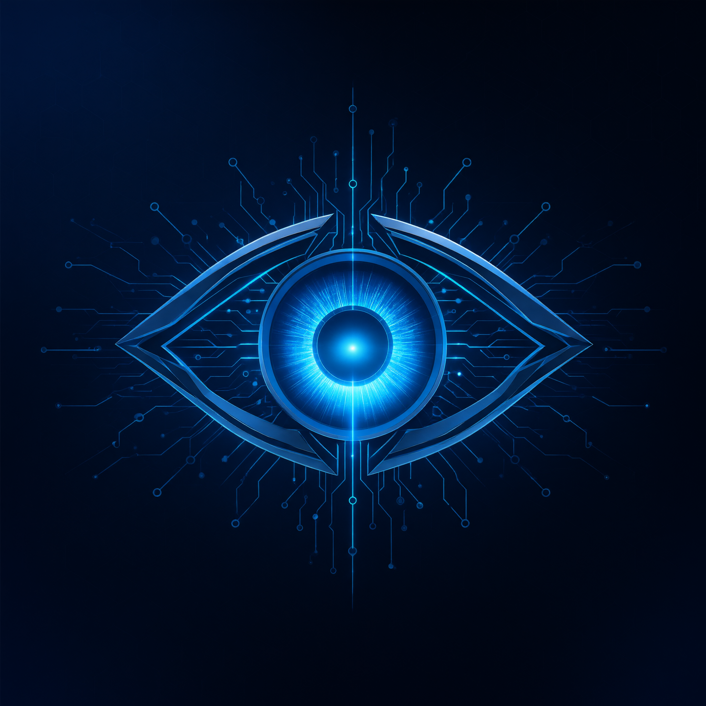
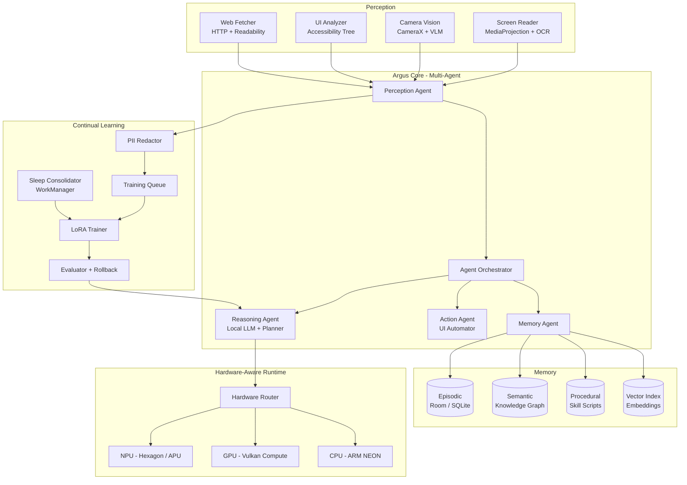

<div align="center">



# ARGUS

### Your Pocket AGI — 100% On-Device. Zero Cloud. Zero API.

[](https://kotlinlang.org)
[](https://developer.android.com/build)
[](https://gradle.org)
[](https://openjdk.org)
[](https://developer.android.com/tools)
[](https://developer.android.com/tools)
[](LICENSE)

> *A hundred eyes. One mind. Zero cloud.*

Argus is an experimental **on-device AGI framework** for Android.
It perceives (screen, camera, files, web), remembers (episodic / semantic /
procedural memory), reasons (local LLM + multi-agent planner), acts
(opt-in UI automation), and **continually learns** — without a single byte
of user data ever leaving the device.

</div>

---

## ⚠️ Status & Disclaimer

> **Research-grade, pre-alpha software.**
> Argus is an exploration of what a *personal, local, lifelong-learning*
> intelligence can look like on mobile hardware. Expect rough edges,
> breaking changes, and heavy compute. **Not** intended for production
> or safety-critical use.

All perception features (screen capture, camera, accessibility) are
**opt-in, user-consented, indicator-visible, and pausable at any time**.

---

## 🧠 What Argus Is (and Is Not)

| ✅ Is | ❌ Is Not |
|---|---|
| A local-first AGI *architecture* (perception → memory → reasoning → action → learning) | A wrapper around a cloud LLM API |
| A multi-agent system running asynchronously on-device | A single-prompt chatbot |
| A continual learner via lightweight adapters (LoRA) + memory consolidation | A full fine-tuning pipeline |
| A privacy fortress: 0 telemetry, 0 analytics, 0 exfiltration | A data collector |

---

## ✨ Feature Highlights

- **On-device inference** — local LLM / VLM / OCR / embedding models with
  hardware-aware routing across **NPU (Hexagon / APU) → GPU (Vulkan compute) → CPU (NEON)**.
- **Multi-agent core** — Perception, Reasoning, Action, and Memory agents
  coordinated by an orchestrator over a local message bus.
- **Human-like memory** — episodic, semantic (knowledge graph), procedural,
  plus a local vector index for retrieval.
- **Sleep & consolidation** — deferred "dreaming" phase (charging + idle +
  thermal-safe) that replays, prunes, and consolidates memories without
  catastrophic forgetting.
- **Continual learning** — capture → PII redaction → dedup → **user approval**
  → LoRA adapter training → evaluation → automatic rollback.
- **Screen understanding** — MediaProjection + OCR + UI-tree analysis with
  consent dialog, persistent indicator, and secure-app exclusion.
- **Camera vision** — foreground-only document scan, object understanding,
  visual QA.
- **Web grounding without cloud AI** — raw HTTP fetch + readability
  extraction + local summarization; web content is treated as *untrusted
  data, never as instructions*.
- **Autonomous action (opt-in)** — UI automation with sandboxed dry-run and
  **biometric gate** for sensitive operations.
- **Full transparency dashboards** — model stats (params, quantization,
  context, tok/s, memory, backend) and training pipeline state
  (queued / approved / rejected / trained / failed + reasons).
- **Kill switch** — one global pause that halts every capture, training,
  fetch, and background agent.

---

## 🏗️ Architecture



### Memory Model

| Type | Contents | Engine |
|---|---|---|
| Episodic | Events, conversations, context snapshots | Room / SQLite (encrypted) |
| Semantic | Facts, preferences, entity relations | Embedded knowledge graph |
| Procedural | Learned UI task scripts ("how to do X") | Versioned skill store |
| Vector | Chunk embeddings for retrieval (RAG) | Local ANN index |

### Learning Pipeline

```
capture → redact (PII/OTP/secrets) → dedupe → score → USER APPROVAL
        → LoRA train (charging+idle+thermal-safe) → eval benchmark
        → promote adapter | auto-rollback
```

Raw captures are **never** trained on directly. Unanswerable queries become
*training candidates*, not training data.

---

## ⚙️ Hardware-Aware Runtime

| Tier | Backend | Use Case |
|---|---|---|
| 1 | NPU (Qualcomm Hexagon / MediaTek APU) | Always-on perception, light inference |
| 2 | GPU (Vulkan compute) | Heavy inference, adapter training |
| 3 | CPU (ARM NEON, mmap) | Fallback, low-thermal mode |

The `HardwareRouter` probes SoC, GPU family (Adreno / Mali), Vulkan compute
support, RAM, and thermal state at boot, then selects a device profile
(`low` / `medium` / `high`). Unstable GPU drivers trigger automatic CPU
fallback with degraded context length.

---

## 🛠️ Tech Stack

| Layer | Choice |
|---|---|
| Language | Kotlin 2.1, C++20 (native) |
| Build | Gradle 8.13, AGP 8.7.x, JDK 21 LTS |
| UI | Jetpack Compose (Material 3) |
| DI | Hilt |
| Async | kotlinx-coroutines, WorkManager |
| Storage | Room (SQLCipher), DataStore, SAF |
| Inference | llama.cpp (GGUF), ONNX Runtime Mobile, MediaPipe |
| Native | NDK r27, CMake 3.22+, Vulkan SDK |
| Vision | CameraX, ML Kit OCR (on-device mode) |
| Min / Target SDK | 33 / 36 |

---

## 📱 Requirements

**Build machine**
- JDK 21, Android Studio (latest stable), NDK r27+, CMake 3.22+
- ~15 GB free disk (toolchain + model artifacts)

**Target device**
- Android 13+ (API 33), **ARM64-v8a only**
- 8 GB+ RAM recommended (12 GB+ for >1B-param models)
- 15 GB+ free storage for models + datasets
- Vulkan 1.1+ recommended (optional, CPU fallback exists)

---

## 🚀 Getting Started

```bash
git clone https://github.com/<your-org>/argus.git
cd argus
git submodule update --init --recursive   # llama.cpp, onnxruntime-mobile, etc.
```

Place model artifacts (BYO weights — see [Model Licensing](#model-licensing)):

```
/storage/emulated/0/Android/data/com.argus.agi/files/models/
├── argus-core-1.7b-q4_k_m.gguf    # reasoning / chat
├── argus-vision-0.6b-q4.gguf      # image understanding
├── argus-ocr-0.1b-f16.tflite      # screen text extraction
└── argus-embed-0.3b-f16.onnx      # retrieval embeddings
```

Build & install:

```bash
./gradlew :app:assembleDebug
adb install app/build/outputs/apk/debug/app-debug.apk
```

First launch runs the onboarding: storage grant → model integrity check
(SHA-256) → tiny inference smoke test → optional perception consents.

---

## 📂 Project Structure

```
app/src/main/
├── cpp/                          # Native inference, Vulkan kernels, JNI
│   └── CMakeLists.txt
└── java/com/argus/agi/
    ├── core/
    │   ├── agent/                # Orchestrator + Perception/Reasoning/Action/Memory agents
    │   ├── memory/               # Episodic, Semantic, Procedural, Vector + SleepConsolidator
    │   ├── model/                # LocalInference, ModelManager, HardwareRouter
    │   └── training/             # TrainingQueue, LoRATrainer, DataRedactor, Evaluator
    ├── perception/               # ScreenReader, CameraVision, UIAnalyzer, WebFetcher
    ├── action/                   # UIAutomator, AppLauncher, BiometricGate
    ├── ui/                       # chat/, dashboard/, privacy/, settings/
    └── di/                       # Hilt modules
```

---

## 🔐 Privacy & Security Model

- **Offline-first.** No network call is possible unless the user enables
  internet; web fetches are allowlist-able and fully logged locally.
- **No telemetry.** No analytics, no crash reporting, no third-party SDKs
  with network permissions. Logs are local and user-exportable only.
- **Consent-first perception.** MediaProjection / camera / accessibility
  require explicit grants, show persistent indicators, and honor a global
  kill switch that halts all capture within one second.
- **Sensitive-app exclusion.** Banking, password managers, and
  `FLAG_SECURE` surfaces are blacklisted by default.
- **Redaction before storage.** PII, credentials, OTPs, and secrets are
  scrubbed pre-queue; raw frames are never persisted unapproved.
- **Prompt-injection defense.** All external content (web, files, OCR,
  screen) is sandboxed as data; tool calls require policy checks, and
  sensitive actions require biometric confirmation.
- **Encrypted at rest.** SQLCipher for memory stores; atomic writes;
  secure deletion on user request.

Report vulnerabilities privately via `SECURITY.md` — do not file public issues.

---

## 🧪 Testing

- **Unit:** agent routing, redaction rules, memory CRUD, adapter eval gates.
- **Instrumented:** inference smoke tests, capture pause latency (<1 s),
  no-network assertions with internet disabled.
- **Privacy suite:** secure-app exclusion, redaction recall, deletion
  completeness.
- **Adversarial:** prompt-injection corpus from web/file/OCR channels.
- **Device matrix:** Snapdragon/Adreno + MediaTek/Mali, RAM 4–12 GB,
  API 33–36, battery-saver and thermal-throttle scenarios.

---

## 🗺️ Roadmap

- [x] Local chat + RAG + file/image import
- [ ] Web fetch grounding + citations
- [ ] On-demand screen understanding
- [ ] Sleep consolidation + LoRA continual learning
- [ ] Autonomous action with biometric gate
- [ ] Multi-device federated memory (local LAN only)

---

## 🤝 Contributing

Contributions welcome — especially in quantization, Vulkan kernels, and
on-device training stability. Read `CONTRIBUTING.md`, keep commits signed,
and respect the privacy-first design principles: **no network by default,
no mocks in production, no silent capture, ever.**

---

## 📄 License & Model Licensing

- **Code:** Apache-2.0 (see [LICENSE](LICENSE)).
- **Models:** Argus ships **no weights**. You supply your own models under
  their respective licenses (GGUF/ONNX/TFLite artifacts are user-provided).
- **Icon & brand:** © Argus Project.

---

## 🙏 Acknowledgements

[llama.cpp](https://github.com/ggerganov/llama.cpp) ·
[ONNX Runtime](https://onnxruntime.ai) ·
[MediaPipe](https://developers.google.com/mediapipe) ·
[AndroidX](https://developer.android.com/jetpack) ·
and every developer who believed a phone could hold a mind.

---

<div align="center">

**Seratus mata. Satu pikiran. Nol cloud.**
Built with 🔥 on ARM64.

</div>
